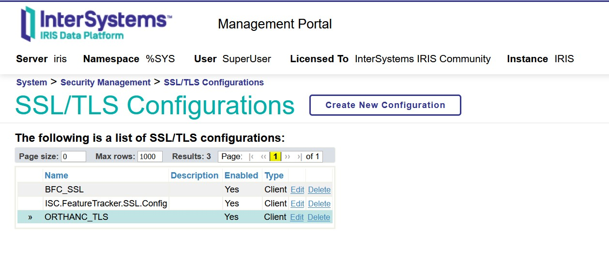
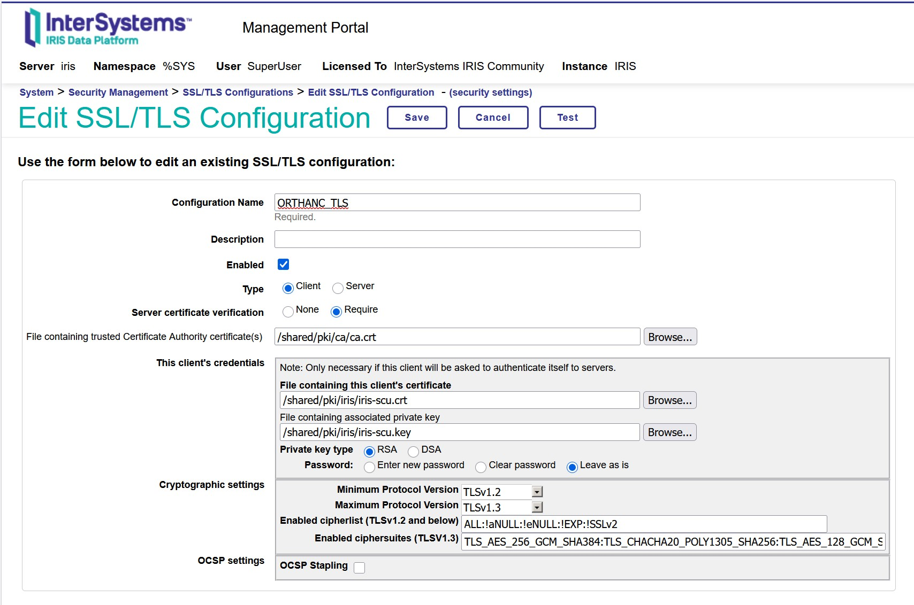
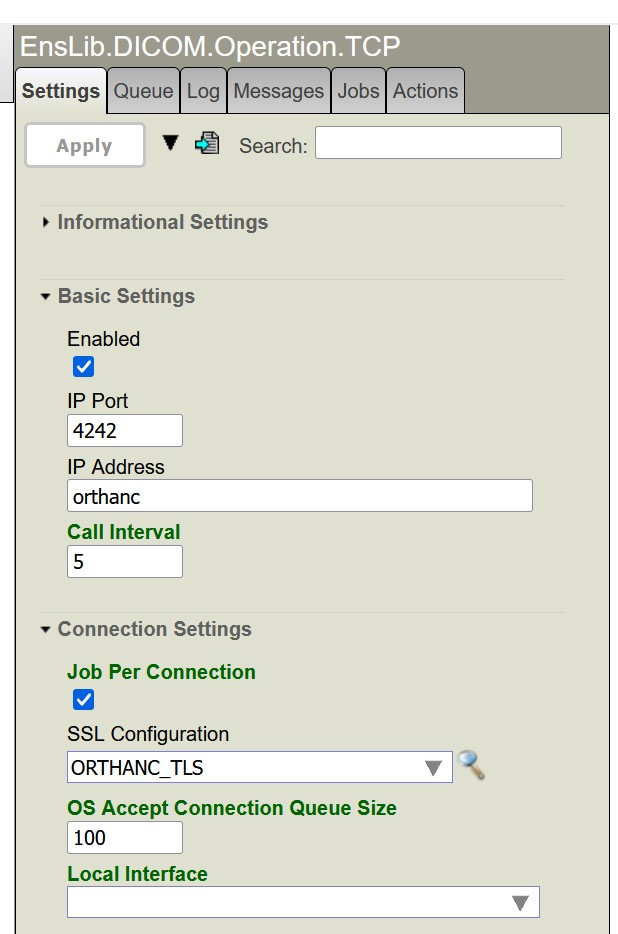

# Creation of certificates for mTLS between IRIS and Orthanc

## Step 1 - Generate Certification Authority certificate

```console
openssl genrsa -out shared/pki/ca/ca.key 4096
openssl req -x509 -new -key shared/pki/ca/ca.key -days 3650 -sha256 \
  -subj "/C=ES/O=Demo/OU=DICOM/CN=Demo DICOM CA" \
  -out shared/pki/ca/ca.crt
```

## Step 2 - Generate Orthanc certificates

* Create orthanc-ext.cnf file with the following content:
```console
authorityKeyIdentifier=keyid,issuer
basicConstraints=CA:FALSE
keyUsage=digitalSignature,keyEncipherment
extendedKeyUsage=serverAuth
subjectAltName=DNS:orthanc
```
* Generate certificate signed by CA
```console
openssl genrsa -out shared/pki/orthanc/orthanc.key 2048

openssl req -new -key shared/pki/orthanc/orthanc.key -subj "/C=ES/O=Demo/OU=DICOM/CN=orthanc" -out shared/pki/orthanc/orthanc.csr

openssl x509 -req -in shared/pki/orthanc/orthanc.csr -CA shared/pki/ca/ca.crt -CAkey shared/pki/ca/ca.key -CAcreateserial -out shared/pki/orthanc/orthanc.crt -days 825 -sha256 -extfile orthanc-ext.cnf
```

## Step 3 - Generate IRIS certificates

* Create iris-ext.cnf file with this content:
```console
authorityKeyIdentifier=keyid,issuer
basicConstraints=CA:FALSE
keyUsage=digitalSignature
extendedKeyUsage=clientAuth
```
* Generate certificate signed by CA
```console
openssl genrsa -out shared/pki/iris/iris-scu.key 2048

openssl req -new -key shared/pki/iris/iris-scu.key -subj "/C=ES/O=Demo/OU=DICOM/CN=IRIS_SCU" -out shared/pki/iris/iris-scu.csr

openssl x509 -req -in shared/pki/iris/iris-scu.csr -CA shared/pki/ca/ca.crt -CAkey shared/pki/ca/ca.key -CAcreateserial -out shared/pki/iris/iris-scu.crt -days 825 -sha256 -extfile iris-ext.cnf
```

## Step 4 - Concatenate CA and IRIS certificates for Orthanc validation

```console
cat /shared/pki/ca/ca.crt /shared/pki/iris/iris-scu.crt > /shared/pki/trusted/trusted.crt
```

# IRIS and Orthanc configuration for mTLS

## Orthanc configuration

Add into **orthanc.cnf** the configuration of the certifications:

```console
"DicomTlsEnabled": true,
"DicomTlsCertificate": "/shared/pki/orthanc/orthanc.crt",
"DicomTlsPrivateKey": "/shared/pki/orthanc/orthanc.key",
"DicomTlsTrustedCertificates": "/shared/pki/trusted/trusted.crt",
```

Done!

## IRIS/Health Connect configuration

From **System -> Security Management -> SSL/TLS Configurations** create a new configuration (ORTHANC_TLS, for example):


And configure the parameters as are defined in the following image:


Now, with the TLS configuration done we have to set the parameter SSL Configuration from the business operation **EnsLib.DICOM.Operation.TCP** deployed in the interoperability production with the name of the SSL/TLS created before.


And now, your IRIS instance is ready to send DICOM images using mTLS! Congratulations!